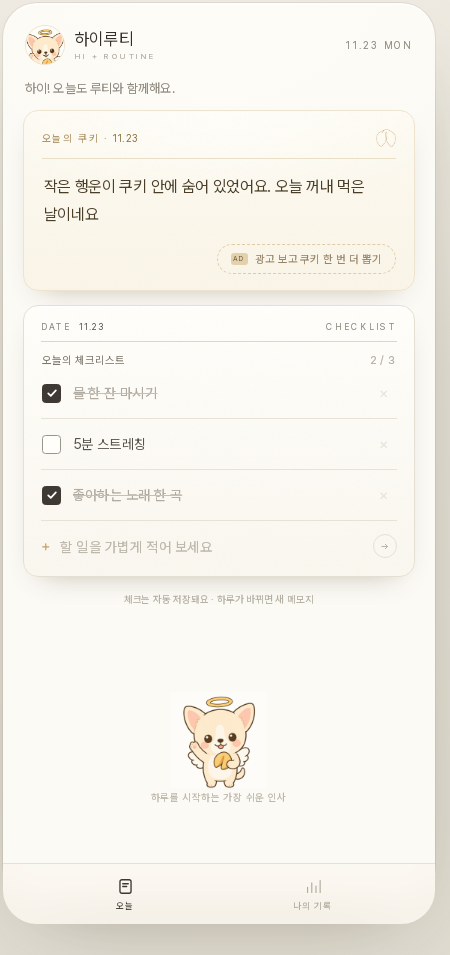
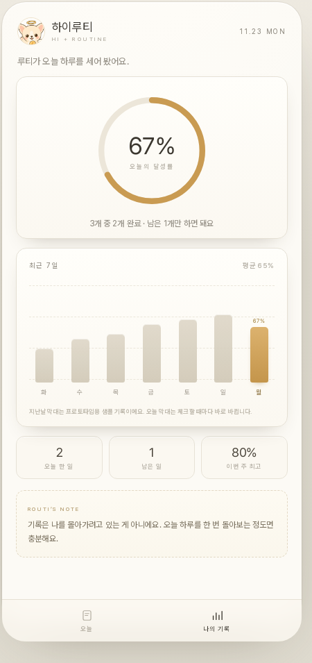

# 하이루티 · HiRouti 🥠

> **하루를 시작하는 가장 쉬운 인사**
> Hi + Routine = HiRouti (안녕, 나의 루틴!)

**바로 열기 → https://gtcgjjgtt5-hue.github.io/hi-routi/**

ADHD-friendly한 떡메모지 체크리스트 + 도파민 포춘쿠키 투두 웹앱 프로토타입입니다.
시간표도, 복잡한 카테고리도 없이 **적고, 체크하고, 오늘의 쿠키를 깨는** 세 가지 동작만 있습니다.

## 무엇이 들어 있나요

- **떡메모지 체크리스트** — 오프화이트 종이 질감, 얇은 회색 괜션, 네모 체크박스 `□`, Pretendard 고딕
- **오늘의 포춘쿠키** — 하루 한 번 쿠키를 깨면 웃음 나는 운세가 체크리스트 위에 하루 종일 붙어 있습니다
- **광고 보고 한 번 더** — 마음에 안 드는 운세는 2초 광고(시뮬레이션) 보고 다시 뽑기
- **나의 기록** — 오늘의 달성률 링 + 최근 7일 막대그래프 (오늘 막대는 체크할 때마다 실시간)
- **PWA** — 홈 화면에 추가하면 앱처럼 실행, 오프라인에서도 열립니다

## 화면

| 오늘 | 나의 기록 |
| --- | --- |
|  |  |

## 실행

정적 파일만으로 동작합니다. 별도 빌드 없음.

```bash
# 로컬에서 열기
python3 -m http.server 8000
# http://localhost:8000
```

GitHub Pages에서 그대로 서빙됩니다 (`main` / root).

## 구조

```
index.html        화면 마크업
styles.css        떡메모지 · 문구점 감성 스타일
app.js            체크리스트 · 포춘쿠키 · 기록 (localStorage)
manifest.json     PWA 매니페스트
sw.js             오프라인 캐시 (서비스 워커)
assets/           루티 마스코트 & 앱 아이콘 & 쿠키 라인아트
```

## 저장 방식

- 체크리스트: 날짜별(`YYYY-MM-DD`)로 `localStorage`에 자동 저장
- 오늘의 운세: 날짜별로 한 번 뽑은 문구 유지, 자정이 지나면 새 메모지
- 지난 6일 그래프는 프로토타입용 샘플 데이터입니다

## 루티 (Routi)

하이루티의 마스코트. 머리 위에 작은 링을 두른 **치와와 천사** 루티가 늘 포춘쿠키를 안고 손을 흔들고 있습니다.
